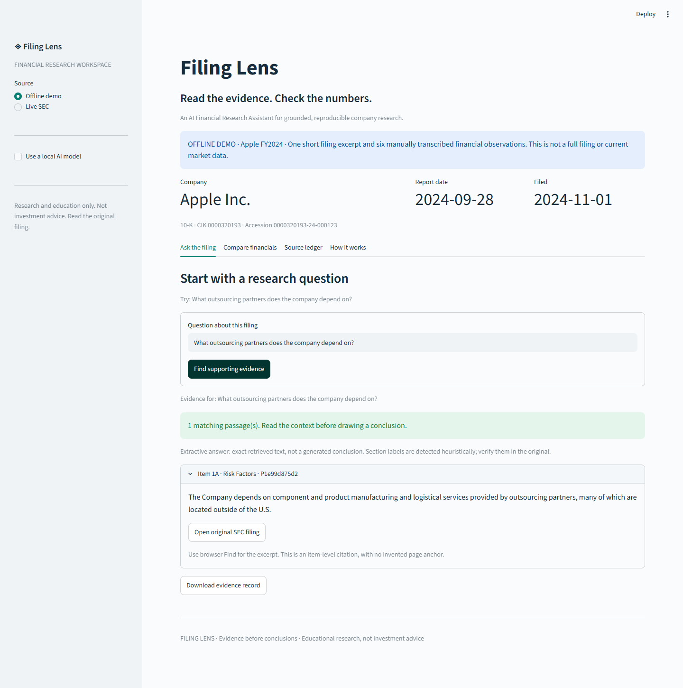

# Filing Lens

**An AI Financial Research Assistant that keeps the filing beside the answer.**

Explore SEC 10-Ks, retrieve cited passages, compare annual financial facts, and optionally
ask a local language model to explain the evidence. Built for a finance student learning Python.

Research and education only. Not investment advice. Verify conclusions in the original filing.

## Use as an AI skill

The repository is also a self-contained **Filing Lens skill**. [SKILL.md](SKILL.md) tells an AI
agent how to retrieve evidence, select a reporting period, cite sources, and use deterministic
calculations. The agent uses its own reasoning; this mode needs neither Ollama nor a separate API.

For Codex, clone the whole repository into your skills directory (usually `~/.codex/skills/filing-lens`),
then restart Codex or open a new session so it can discover the skill:

```bash
git clone https://github.com/andrewgarofalo05-jpg/filing-lens.git ~/.codex/skills/filing-lens
```

On Windows PowerShell, use `$env:USERPROFILE/.codex/skills/filing-lens` as the destination.
If you customized `CODEX_HOME`, use its `skills/filing-lens` directory instead. Do not overwrite
an existing skill directory. Other agents that support SKILL.md can load this bundle using
their own skill installation mechanism; compatibility with every agent is not guaranteed.

Example request: **“Use $filing-lens to compare Apple's FY2024 revenue with the prior year and
explain its outsourcing risks, citing the SEC filing.”** Live access requires a real SEC contact.
Try the helper offline first, from the repository with uv installed:

```bash
uv run --frozen python -m filing_lens.research --demo --metric Revenue
```

The JSON helper supports `--list-filings`, explicit `--accession`, `--question`, `--metric`,
`--end` and `--cache-dir`. Read [the skill](SKILL.md) for the source and accounting boundaries.



## Start here — free offline demo

Install Python 3.11 or newer, then open a terminal in this repository.

```powershell
# Windows PowerShell. Activation is unnecessary.
py -3.11 -m venv .venv
.venv\Scripts\python -m pip install -e ".[dev]"
.venv\Scripts\python -m streamlit run app.py
```

macOS/Linux:

```bash
python3 -m venv .venv
.venv/bin/python -m pip install -e ".[dev]"
.venv/bin/python -m streamlit run app.py
```

Open http://localhost:8501. Dependency installation needs internet; the default demo then
works offline. No account or API key is required. If you use another installed Python version,
replace `py -3.11` with `py -3.12` (or your version). Tested versions are recorded in CI.

**Have uv?** `uv sync --extra dev --frozen`, then `uv run streamlit run app.py`.
The committed `uv.lock` records the resolved environment; pip installs use compatible ranges.

## What works

- **Evidence Q&A:** local lexical retrieval returns exact passages, item labels, stable IDs,
  accession and original filing links. Weak matches abstain. Search is not a generative model.
- **Optional AI:** local Ollama produces qualitative drafts using retrieved evidence; every
  claim needs a known passage ID. The interface labels drafts as unverified.
- **Annual comparisons:** revenue, net income and operating income; exact USD values,
  absolute changes and percentage changes computed with Decimal, independent of AI.
- **Source ledger:** reporting dates, filing dates, concept names, retrieval timestamps and
  downloadable evidence/financial JSON. No invented page numbers or deep links.
- **Live SEC:** ticker or CIK lookup, recent original 10-K selection, cached filing and XBRL facts.

## Try it in two minutes

1. Keep **Offline demo** selected. This is a tiny Apple FY2024 excerpt and manually transcribed
   financial sample, not a full filing or a live SEC download.
2. Ask: **What outsourcing partners does the company depend on?**
3. Expand the evidence card and follow the SEC link to Item 1A, page 8.
4. Open **Compare financials**. Revenue rises from $383.285bn to $391.035bn:
   $7.750bn, approximately 2.02%. Notice the 53-week/52-week comparability warning.
5. Try an unrelated question. An unsupported answer should not appear.

See [the demo walkthrough](docs/DEMO.md) and [screenshots](docs/screenshots/).

## Connect live filings

Select **Live SEC**, enter a ticker (or CIK), and supply your real name and email in the
contact field. Click **Find company**, select a 10-K, then **Load selected filing**.
The contact is sent in the SEC User-Agent and kept only in the running session.
Do not put personal contact information in screenshots or Git.

The app uses at most about 1.67 requests/second per process, a 24-hour local cache, bounded
timeouts/retries and a 25 MB response limit. A 403/429 triggers a cooldown; no bypass is attempted.
The SEC limit applies across all your programs/devices: avoid concurrent instances.
If SEC blocks your network, use the demo and try later. See [data methodology](docs/METHODOLOGY.md).

## Turn on local AI (optional)

Install [Ollama](https://ollama.com/) and a local model that fits your computer; this can require
several GB of download, disk space and RAM. Review the model's own license. The app does not
download a model for you. For example, after choosing a model yourself:

```text
ollama pull YOUR_CHOSEN_LOCAL_MODEL
```

Start Ollama, enable **Use a local AI model**, click **Find installed models**, select a model,
and retrieve evidence. Then click **Draft explanation with local AI**. Only localhost:11434
is contacted; cloud models are excluded. For additional assurance, disable cloud features in
your Ollama setup or run inference offline after downloading the model.

An AI draft can still misinterpret a valid citation. Citation-ID checks prove references exist;
they do **not** prove a sentence is true. Numeric model output is rejected by a simple guard;
spelled-out quantities are not a complete solvable validation problem, so never use AI drafts
for financial calculations. Compare financials is the authoritative arithmetic path.

No paid-provider integration is included. A ChatGPT subscription does **not** supply separate
API billing or credentials. See [architecture and future AI options](docs/ARCHITECTURE.md).

## Check the project

Run with your virtual environment's Python:

```bash
python -m pytest
python -m ruff check .
python -m ruff format --check .
python scripts/evaluate.py
python -m build
```

Tests run offline. They cover date/units/accession selection, conflicting facts, zero/negative
baselines, citations, SEC error paths, model-output validation and the Streamlit flow.
The evaluation is a small regression set, **not** an accuracy benchmark across SEC filings.
See [verification results](docs/VERIFICATION.md).

## Read the code without getting overwhelmed

| File | What to learn |
| --- | --- |
| `src/filing_lens/models.py` | Small named records |
| `src/filing_lens/financials.py` | Financial logic and exact arithmetic |
| `src/filing_lens/filings.py` | HTML cleanup, sections and ranked text retrieval |
| `src/filing_lens/sec.py` | Responsible network requests and caching |
| `src/filing_lens/local_ai.py` | A bounded local AI integration |
| `app.py` | The user interface connecting these pieces |
| `tests/` | Examples of expected behavior and failures |

[Learning plan](docs/LEARNING_PLAN.md) · [Contributing](CONTRIBUTING.md) ·
[Security/privacy](SECURITY.md) · [Release draft](docs/RELEASE.md)

## Known limits

US-GAAP original annual 10-Ks only; recent SEC submissions only. No 10-Qs, amendments, IFRS,
segment facts, custom tags, forecasting, backtesting, trading or portfolio recommendations.
Parser item labels are heuristic. Keyword retrieval can miss paraphrases or retrieve irrelevant
passages. A valid citation is a route to checking evidence, not a guarantee of support.
Financial comparisons use the selected filing's comparative statements, so older periods can
reflect restatements reported in that filing. No automatic reconciliation with later amendments.
Unsupported concepts or incompatible periods are reported rather than guessed.

## License and attribution

Code: [MIT](LICENSE). Filing excerpts and financial data: [data notice](DATA_NOTICE.md).
Not affiliated with or endorsed by the SEC, Apple, Ollama or any model provider.
No GitHub stars, adoption, live-data coverage or AI accuracy claims are made.
