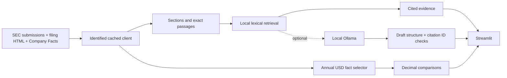

# Architecture and AI boundaries

This is a small retrieval-augmented generation (RAG) application when local AI is enabled.
Retrieval runs without a model: its job is to select source passages. Generation is a separate,
optional call that asks a model to explain those passages. Without Ollama, the app returns
source excerpts, not AI-generated prose. This distinction is intentional and visible in the UI.

The v1 does not need a vector database, embedding API, agent framework or paid subscription.
Plain Python modules and dataclasses are easier to understand and test at 3–5 hours/week.

### Local AI contract

Only an installed model at `127.0.0.1:11434` is accepted. The app lists models, excludes cloud
names/remote metadata, checks model details, and submits one bounded non-streaming request.
The system message defines the task; question/evidence are a JSON data payload. No tool
definitions are provided. Output must contain at most three claims, each with known citation IDs.
Invalid JSON, unknown IDs, empty citations and numeric symbols reject the draft. A failed draft
does not discard the evidence. Temperature zero improves consistency but does not prove truth.

The app cannot algorithmically verify that a cited passage entails a sentence. Prompt injection
can still influence model wording; removing model tools limits its effect. Drafts are explicitly
unverified and rendered as plain text. Numerical comparisons never use model output.

### Future provider adapter (not implemented)

Add a paid provider only after the user has actual API access, accepts its billing and data
handling, and chooses to send questions/excerpts there. Keep it behind the same narrow interface
and add mocked tests and an explicit opt-in. Never infer API access from a ChatGPT subscription.
A provider API key belongs in environment variables or ignored Streamlit secrets, never Git.

Official interface references:
[Ollama chat](https://docs.ollama.com/api/chat),
[Ollama model listing](https://docs.ollama.com/api/tags),
[Streamlit AppTest](https://docs.streamlit.io/develop/api-reference/app-testing/st.testing.v1.apptest).
