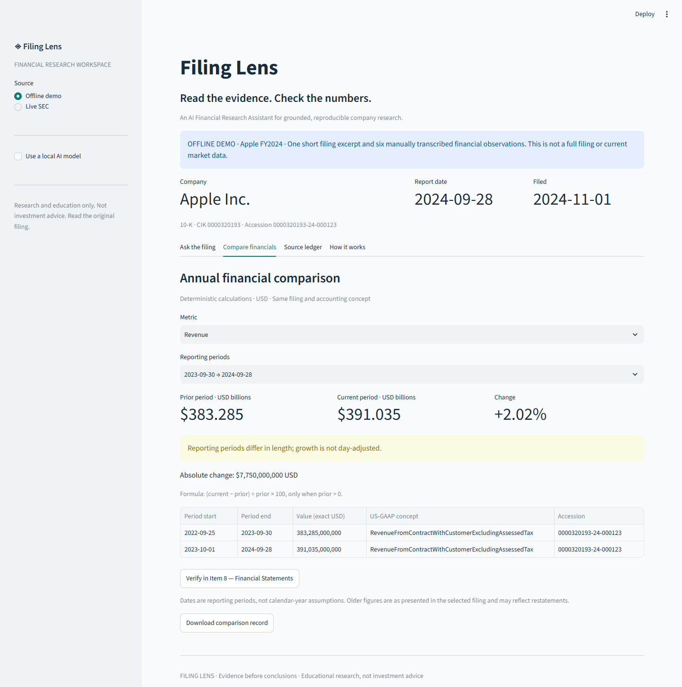
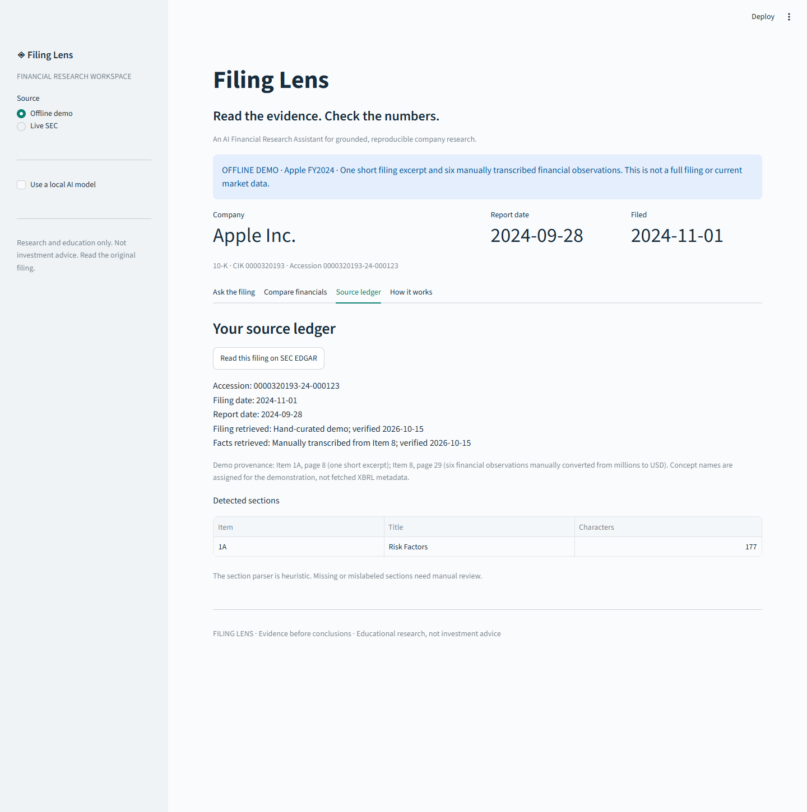

# A two-minute project demo

Use the offline example so the demo is repeatable and never displays your email.

**0:00 — The problem.** “Financial research tools can produce polished answers that are hard
to check. I wanted the evidence and calculation inputs to stay visible.”

**0:20 — Evidence.** Ask “What outsourcing partners does the company depend on?” Show the
exact excerpt, Item 1A label, passage ID and SEC link. Explain that the default is local search.

**0:50 — Numbers.** Open Compare financials. Show the $7.750 billion revenue change and
2.02% growth, then the exact values, dates and concept. Point out the unequal-year warning.

**1:20 — Trust boundaries.** Ask about quantum gravity. Show abstention. Explain that missing
financial values are not filled in, and optional AI prose cannot supply arithmetic.

**1:40 — Reproducibility.** Download a source record and show the tests. Be candid that the
offline sample is curated and the evaluation is small. If Ollama is installed, demonstrate
one qualitative draft and manually compare each claim to its citation.

These are screenshots of the actual running application, not mockups. They intentionally show
the historical offline sample. No screenshots imply that a local generative model was tested.
